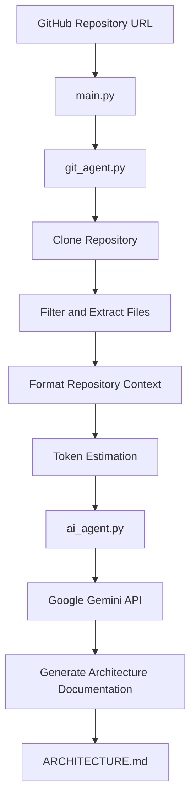

# Repo Doc Agent

**An AI-powered CLI tool that analyzes GitHub repositories and automatically generates technical architecture documentation.**

Repo Doc Agent helps developers understand unfamiliar codebases faster by using Google's Gemini API to analyze source code and produce structured architecture documentation.

## Overview

Understanding an unfamiliar codebase can be time-consuming, especially when documentation is missing or outdated.

Repo Doc Agent automates this process:

1. Accepts a GitHub repository URL.
2. Clones the repository into a temporary directory.
3. Scans and extracts relevant source files.
4. Filters out unnecessary directories, binary files, excluded file types, and oversized files.
5. Prepares the extracted code for LLM analysis.
6. Sends the repository context to Google Gemini.
7. Generates an `ARCHITECTURE.md` file containing a technical overview of the project.

## Features

- **Automated Repository Cloning** — Clone GitHub repositories using GitPython.
- **Intelligent File Filtering** — Exclude unnecessary directories, binary files, configured sensitive files, and oversized files.
- **LLM-Powered Code Analysis** — Use Google Gemini to analyze repository structure and source code.
- **Architecture Documentation** — Generate structured Markdown documentation.
- **Mermaid Diagrams** — Generate architecture flowcharts illustrating components and data flow.
- **Token Limit Estimation** — Estimate the size of the repository context before sending it to the API.
- **Temporary Workspace** — Clone repositories into temporary directories that are automatically cleaned up.

## Tech Stack

| Technology | Purpose |
|---|---|
| Python | Core application |
| GitPython | Git repository cloning |
| Google Gemini API | AI-powered code analysis |
| python-dotenv | Environment variable management |
| pathlib | File system traversal |
| logging | Application logging |

## Architecture

The application follows a modular structure, separating repository processing, AI integration, configuration, and prompt management.

```text
repo-doc-agent/
│
├── main.py          # Application entry point
├── git_agent.py     # Repository cloning and file extraction
├── ai_agent.py      # Gemini API integration
├── config.py        # Configuration and filtering rules
├── prompts.py       # LLM prompts
│
├── requirements.txt # Python dependencies
├── .gitignore
└── README.md
```

### Processing Pipeline



### Core Modules

**main.py**
- Coordinates the application workflow.
- Accepts the repository URL.
- Estimates token usage.
- Handles user confirmation when the estimated context exceeds the configured limit.
- Saves the generated documentation.

**git_agent.py**
- Validates GitHub repository URLs.
- Clones repositories into temporary directories.
- Traverses the file structure using `pathlib`.
- Filters excluded directories, files, extensions, and oversized files.
- Extracts and formats source code for LLM processing.

**ai_agent.py**
- Initializes the Google Gemini client.
- Builds the AI prompt using repository content.
- Sends the request to Gemini.
- Handles API errors and returns generated documentation.

**config.py**
- Loads environment variables.
- Stores API configuration.
- Defines file filtering rules and token limits.
- Configures application logging.

**prompts.py**
- Defines the architecture analysis prompt.
- Specifies the structure and content of the generated documentation.

## Getting Started

### Prerequisites

- Python 3.10 or newer
- Git
- Google Gemini API key

### 1. Clone the Repository

```bash
git clone https://github.com/ternqwe/repo-doc-agent.git

cd repo-doc-agent
```

### 2. Create a Virtual Environment

```bash
python -m venv venv
```

Activate it:

**macOS / Linux**

```bash
source venv/bin/activate
```

**Windows**

```bash
venv\Scripts\activate
```

### 3. Install Dependencies

```bash
pip install -r requirements.txt
```

### 4. Configure Environment Variables

Create a `.env` file in the project root:

```env
GEMINI_API_KEY=your_gemini_api_key
```

Replace `your_gemini_api_key` with your actual Google Gemini API key.

### 5. Run the Application

```bash
python main.py
```

Enter a GitHub repository URL when prompted:

```text
Welcome to Repo Doc Agent!

Enter the GitHub repository URL to analyze:
```

Example:

```text
https://github.com/pallets/flask
```

After successful processing, the generated documentation will be saved as:

```text
ARCHITECTURE.md
```

## Configuration

The application provides configurable filtering and processing limits in `config.py`.

| Setting | Default | Description |
|---|---|---|
| `EXCLUDED_DIRS` | `.git`, `venv`, `node_modules`, etc. | Directories excluded from analysis |
| `EXCLUDED_EXTENSIONS` | Images, archives, PDFs, etc. | File extensions excluded from analysis |
| `EXCLUDED_FILES` | `.env`, `secrets.json`, etc. | Specific filenames excluded |
| `MAX_FILE_SIZE_BYTES` | 100 KB | Maximum file size |
| `TOKEN_LIMIT` | 500,000 | Estimated context token threshold |

These settings can be adjusted depending on the repository being analyzed.

## Limitations

- The current implementation uses a single LLM request containing the formatted repository context.
- Large repositories may exceed the model's available context capacity.
- Token usage is estimated rather than calculated using an exact tokenizer.
- Analysis quality depends on the source code available and the LLM's interpretation.
- Private repositories require appropriate Git authentication, which is not configured by the application itself.
- Generated documentation may require manual review.

**Privacy note:** Repository source code is sent to the Google Gemini API for analysis. Avoid processing confidential repositories or sensitive source code unless you have verified that doing so complies with your organization's security requirements.

## Improvements

- [x] Implement robust file and directory filtering
- [x] Add Git and Gemini API error handling
- [x] Refactor architecture into modular components
- [x] Add Mermaid.js system diagrams generation
- [ ] Add strict Type Hints (mypy)
- [ ] Implement chunking for massive repositories
- [ ] Add Typer for advanced CLI arguments

## License

This project is currently an independent personal project.